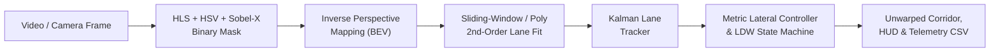

# ADAS Lane Perception & Lateral Control System

A modular, real-time monocular **Advanced Driver Assistance System (ADAS)** perception and lateral control pipeline built in Python and OpenCV.

It detects straight and curved ego lanes, estimates metric vehicle offset and road curvature, computes continuous steering commands, manages Lane Departure Warning (LDW) states, and logs frame-by-frame telemetry.

---

## Architecture



### Key Features
* **Illumination-Robust Feature Extraction (`Utils/preprocess.py`):** Combines HLS white-lane filtering, HSV yellow/orange centerline filtering, and directional Sobel-X gradients with morphological denoising.
* **Bird's-Eye View Projection (`Utils/roi.py`):** Resolution-independent Inverse Perspective Mapping (`PerspectiveTransformer`) for accurate curved-road modeling.
* **Curved-Lane Polynomial Detection (`Utils/lane_det.py`):** 2nd-order polynomial fitting ($x = ay^2 + by + c$) with sliding-window cold start, fast search-around-poly warm tracking, and lane-width / slope-parallelism outlier rejection.
* **Kalman Filter Tracking (`Utils/smoothing.py`):** Per-lane 3-state Kalman filter with confidence-weighted measurement noise, occlusion coasting, and automatic track reset.
* **Metric Lateral Control & LDW (`Utils/control.py`):** Self-calibrated meters-per-pixel lateral offset, road radius of curvature (m), continuous steering angle (deg), and ADAS state machine (`LKA ACTIVE`, `LDW LEFT`, `LDW RIGHT`, `STANDBY`).
* **Automotive HUD & Telemetry (`Utils/draw.py`, `main.py`):** Unwarped drivable corridor, top-left telemetry panel, live top-right Bird's-Eye View inset, MP4 export, and per-frame CSV logging.
* **Config-Driven & Tested:** Centralized tuning in `config.json`, automated unit tests in `tests/`, and a telemetry analyzer in `scripts/analyze_telemetry.py`.

---

## Verified Baseline (`Data/Sample.mp4`)

| Metric | Result |
| :--- | :--- |
| Resolution | `960 × 540` |
| Frames Processed | `450` |
| Lane Tracking Rate | `100.0%` (`LKA ACTIVE`: 446, `LDW`: 4) |
| Average Latency | `~30.5 ms/frame` (`~32.8 FPS` on CPU) |

---

## Project Structure

```text
Lane Det/
├── main.py                     # CLI entrypoint & real-time pipeline loop
├── config.json                 # Centralized perception, BEV, tracker & control config
├── requirements.txt            # Python dependencies
├── SRS.txt                     # Software Requirements Specification & ODD
├── Data/
│   └── Sample.mp4              # Sample driving footage
├── Utils/
│   ├── preprocess.py           # HLS/HSV color + Sobel-X lane binary extraction
│   ├── roi.py                  # PerspectiveTransformer (BEV warp/unwarp) & ROI mask
│   ├── lane_det.py             # PolynomialLaneDetector (sliding window + poly search)
│   ├── smoothing.py            # KalmanLaneTracker (3-state per-lane Kalman filter)
│   ├── control.py              # LateralController (metric offset, curvature, steering, LDW)
│   └── draw.py                 # Unwarped corridor renderer, HUD & mini BEV inset
├── scripts/
│   └── analyze_telemetry.py    # Summarizes telemetry CSV & renders diagnostic chart
├── tests/
│   └── test_pipeline.py        # Unit tests for BEV, detector, Kalman tracker & controller
└── Output/                     # Generated MP4 videos, CSV telemetry & charts (gitignored)
```

---

## Setup & Usage

### 1. Install Dependencies
```powershell
python -m venv LaneDet
.\LaneDet\Scripts\Activate.ps1
pip install -r requirements.txt
```

### 2. Run the Pipeline
```powershell
# Live interactive display (press 'q' to quit)
python main.py

# Save annotated MP4 video + CSV telemetry
python main.py --save-video --telemetry Output/telemetry.csv

# Headless batch run on a custom video
python main.py --input path/to/video.mp4 --output Output/out.mp4 --no-display
```

### 3. Analyze Telemetry & Generate Plots
```powershell
python scripts/analyze_telemetry.py --csv Output/telemetry.csv --plot Output/telemetry_report.png
```

### 4. Run Unit Tests
```powershell
python -m unittest discover -s tests -v
```
